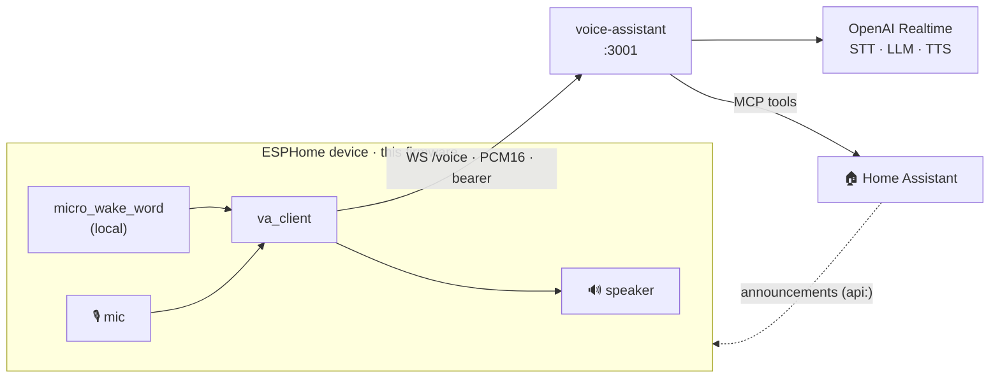

<div align="center">

# 🗣️ home-assistant-voice-pe · va-direct fork

**ESPHome firmware that turns a voice device into a thin client streaming audio
straight to a [`voice-assistant`](https://github.com/maxmaxme/voice-assistant)
backend** — no Home Assistant `voice_assistant` pipeline on the audio path.

[-blue.svg)](LICENSE)
[](https://github.com/esphome/home-assistant-voice-pe)

</div>

---

A customized fork of
[`esphome/home-assistant-voice-pe`](https://github.com/esphome/home-assistant-voice-pe).
It replaces the stock ESPHome `voice_assistant` component with a custom
**`va_client`** component that opens a plain WebSocket to a backend and streams
**PCM16 audio both ways**. The backend ([`voice-assistant`](https://github.com/maxmaxme/voice-assistant))
runs an OpenAI **Realtime** session — STT, the LLM, and TTS all happen there.
Home Assistant is not on the audio path; the backend uses it only as an MCP
tool backend.

Wake word and all LED/UX still run **locally** on the device; on Voice PE the
XMOS co-processor still does AEC / NS / IC / AGC. The device is, in short, a thin
mic-and-speaker client.

The device does keep a native `api:` connection to Home Assistant — but only as
an **announcement / entity channel**: HA sees its `Media Player` (and, on the
Voice PE, Mute / LED Ring / Restart), so scripts and automations can play
`tts.speak` or `media_player.play_media` announcements through it, alongside the
assistant's own voice. The voice path survives HA being down.

## 🧭 How it works



`idle → listening → thinking → replying` phases are driven by JSON messages from
the backend; binary frames are raw PCM16. The device owns its own turn
lifecycle: a stop, a cancel or a watchdog ends the turn **locally** and only
tells the backend, and every turn carries an id (protocol v2) so late messages
from a turn the device already closed are dropped. The contract lives in
voice-assistant's `src/realtime/protocol.ts` — **change both sides in
lockstep**.

> **Follow-up turns are server-driven.** After a spoken reply the backend sends a
> `follow_up {ms, chime?}` event (before the end-of-turn idle) telling the device
> to reopen the mic so you can continue without a wake word; a silent
> `wait_for_user` or a barge-in does not. Window lengths and whether a question
> plays a chime are set in the voice-assistant web panel. See CLAUDE.md.

## 📟 Supported devices

| Config (flashed)                     | Device                                  |
| ------------------------------------ | --------------------------------------- |
| `home-assistant-voice.va-direct.yaml` | [Home Assistant Voice PE](https://www.home-assistant.io/voice-pe/) (XMOS DSP, LED ring) |
| `atom-echo-s3r.va-direct.yaml`        | M5Stack Atom Echo S3R (ESP32-S3, ES8311 codec — mic and speaker share one I2S bus) |

Both pull the `va_client` component from `esphome/components/` (local) and run
`micro_wake_word` on-device, plus a `stop` model to interrupt the assistant.
The upstream configs (`home-assistant-voice.yaml`, `.8mb.yaml`,
`.factory.yaml`) are kept untouched for reference / upstream sync — they are
not built here.

## 🔧 The `va_client` component

`esphome/components/va_client/`, built on `esp_websocket_client` (esp-idf):

| File | Role |
| --- | --- |
| `va_core.h` | **Functional core** — the protocol state machine, watchdogs, server-message handling, and the input decisions the yaml asks for (what a wake word / button press should do, when the `stop` model is armed, what the LED ring shows). Pure: no ESPHome / esp-idf includes, time is injected, side effects come back as a list of actions. |
| `bus_arbiter.h` | **Shared-I2S-bus arbitration** for the Atom, whose mic and speaker take turns on one bus: decides when the mic may hold it vs. the reply, rtttl tones and HA media. Also pure. |
| `va_client.h` / `.cpp` | The **shell**: the WebSocket, the mic/speaker audio plane (a PSRAM ring buffer smooths playback), triggers (`on_phase`, `on_followup_opened`, `on_repeated_failure`). |
| `__init__.py` | ESPHome schema / codegen. |

**Decisions live in C++, choreography in yaml.** The yaml keeps chimes, delays
and speaker stops; anything that decides *what should happen* is asked from the
core, so it is covered by the tests below. The deep dive — phase semantics,
watchdogs, the AEC / follow-up caveat, the yaml glue — is in
[CLAUDE.md](CLAUDE.md).

`esphome/components/udp_log/` forwards device logs as JSON over UDP to a log
sink on the backend host.

## 🧪 Tests

```bash
./tests/host/run.sh
```

Runs on a plain host compiler (no ESPHome / esp-idf needed), in CI too:

- **Example tests** for `va_core` and `bus_arbiter`.
- **Invariant fuzzing**: seeded random sequences of wake / stop / barge-in /
  button presses, WebSocket drops and server messages in any order (the
  backend can race, dedupe or go stale), checking after every step that e.g.
  the mic always closes on its own, it only streams while the ring shows
  listening, no follow-up window opens after a stop, and a message for a
  closed turn changes nothing. The Atom's bus arbitration gets the same
  treatment (never deaf, no bus contention). A failure prints the seed and the
  event trace to reproduce it.

CI also `esphome compile`s both va-direct configs.

## 🚀 Build & flash

Stock ESPHome workflow. Flashing is OTA (the devices ship on Wi-Fi). Hostnames
carry a fixed MAC suffix (`name_add_mac_suffix`) and are advertised over mDNS
— find them with `dns-sd -B _esphomelib._tcp local`:

```bash
esphome run home-assistant-voice.va-direct.yaml --device home-assistant-voice-<mac6>.local
esphome run atom-echo-s3r.va-direct.yaml        --device atom-echo-s3r-<mac6>.local
```

`./flash-all.sh` flashes both in parallel. The local components are picked up
automatically via each config's `external_components:` block. UI sounds ship in
the repo's `sounds/`, so a compile needs no network for them. USB-C is only a
recovery fallback.

**Wi-Fi** is not in any file: provision it on first boot via Improv (Voice PE,
BLE or serial) or by joining the device's fallback access point and using the
captive portal. Credentials then live in the device's NVS.

## 🔑 secrets.yaml

Gitignored. Provide:

- **`va_device_token`** — the Voice PE's bearer for the backend WebSocket.
- **`va_device_token_atom`** — the Atom Echo's own bearer.
- **`ap_password`** — password of both configs' fallback Wi-Fi access point.

The backend URL is a `va_url` substitution at the top of each config, not a
secret.

The backend authenticates **per device**: it hashes the presented token and
looks it up among its registered `voice` identities. So register each device's
token in the backend — its web panel **Users** page, or
`npm run users -- attach-voice --user <id> --token <token>`. An unregistered
token is rejected at the handshake (`4401`) and the failure cue plays after a
few retries.

## 🔁 Relation to upstream

Stay close to `esphome/home-assistant-voice-pe` so upstream fixes for the XMOS /
voice-kit / LED stack can be pulled in. The fork-side delta is intentionally
small: the **`va_client`** and **`udp_log`** components, the
**`*.va-direct.yaml`** configs, and `secrets.yaml` keys. Avoid editing upstream
files unless cherry-picking from upstream or fixing something that genuinely
needs a fork-side change.

**Changes from upstream (2026):** added `esphome/components/va_client/` (GPLv3)
replacing the stock `voice_assistant` audio path, `esphome/components/udp_log/`,
the host tests under `tests/host/`, and the `*.va-direct.yaml` configs that
wire them (mic, speaker, LED phases, cues). The original
`home-assistant-voice.yaml` is left untouched.

## 📄 License

Unchanged from upstream — the **ESPHome dual license** (see [LICENSE](LICENSE)):
C++/runtime files (`.c .cpp .h .hpp .tcc .ino`) are **GPLv3**, everything else is
**MIT**. The `va_client` component is therefore GPLv3.
